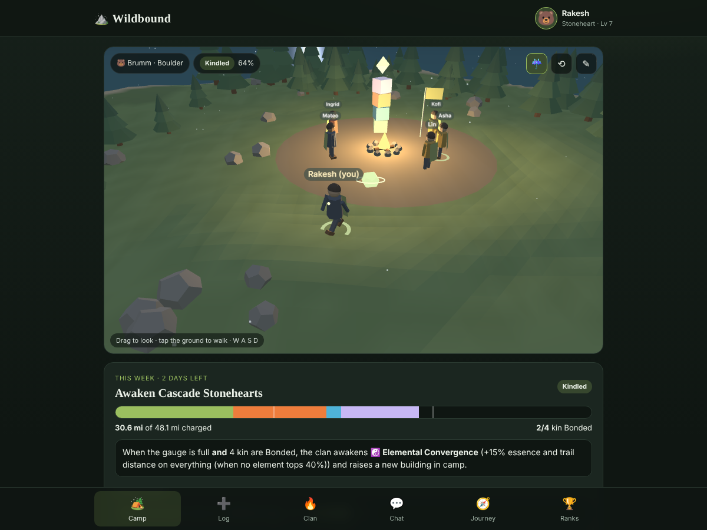

# ⛰️ Wildbound

**Move together. Explore the world.**

Wildbound is a clan-based movement game. Your walks, lifts, runs, swims and matches feed an elemental spirit companion. They also carry your clan along **real-world trails**, such as the Inca Trail, Everest Base Camp, Hadrian's Wall, the Camino de Santiago and the Appalachian Trail. Each waypoint your clan reaches unlocks a short piece of the geography and history of that land.

> We evolved as hunter-gatherers: walking, carrying, climbing and roaming in tribes. Wildbound tries to bring back that instinct: move with your people, toward a shared horizon, and get curious about the land along the way.

| 3D clan camp | Log + "What this does" | Clan chat (mobile) |
|---|---|---|
|  |  |  |

## Core loop (Seattle edition, v0.2)

```
Move in real life ──► sync (Strava / Apple Health / Health Connect / Garmin) or log manually
        │
        ├─► Essence ─────────► your element spirit evolves (4 forms)
        ├─► Element energy ──► the clan's WEEKLY AWAKENING gauge
        ├─► Active day ──────► you become "Bonded" (3 days this week)
        └─► Trail distance ──► the clan marker walks a real route and unlocks lore

Gauge full + 60% of kin Bonded ──► ⚡ CLAN AWAKENS
   • a Power for 2 weeks (decided by which element's energy led the week)
   • a new building rises in the 3D camp
   • +150 essence for everyone
```

Because the Awakening needs **60% of members Bonded**, the clan can't be carried by one athlete. Clan chat, the daily **Rally**, and cheering exist to get sleepy members moving. In balance testing, the simulated clanmates alone never awaken, while about 8 mi over 4 days from you plus one rally tips the clan over.

### What does a 10-minute walk do?
On the Log screen, the "What this does" panel answers this for any activity before you save it. A 10-minute easy walk gives:
- +10 essence for your spirit (+15 if you're Air, the walking element),
- about 0.5 mi of **Air energy** for the clan gauge,
- one more day toward being **Bonded**,
- about 0.5 mi along the current journey,
- possibly a daily trial such as "Move for at least 10 minutes".

## Features
- **3D clan camp** (Three.js): a low-poly island on Puget Sound with Rainier, the Olympics and the Space Needle on the horizon, and the sky following Seattle's time of day (optional rain ☔). Your avatar walks around (tap the ground or use WASD) with your spirit companion. Your kin stand around the fire, with a glowing ring when they're Bonded. The element totem glows with the week's energy, and each Awakening adds a building.
- **Badges are gear:** boots, clan cloak, sun amulet, lantern, explorer's pack, Rain Shell and more appear on your avatar.
- **Clan Powers:** Mountain's Endurance (Earth), Wildfire Rally (Fire), Tidal Recovery (Water), Tailwind (Air), and Elemental Convergence when the clan's energy is balanced.
- **Clan chat:** activity cards, cheers (+2 essence), a daily Rally that raises sleepy kin's chance to move, and replies from simulated clanmates.
- **Journeys:** Seattle Urban Trek → Snoqualmie Valley & Mount Si → Wonderland Trail → Inca Trail → Everest Base Camp → Camino de Santiago, with landmark lore. There are also **Seattle check-ins**: Green Lake, Kerry Park, Seward Park, Golden Gardens, the Arboretum and Magnuson Park.
- **Ranks:** weekly clan table (distance per member × Bonded share), kin awards (Trailblazer, Steady Flame, Wayfinder) and the element balance across Seattle.
- **Units:** miles and feet by default, with a kilometres option.

## Run it

There is no build step. It's plain HTML, CSS and ES modules.

```bash
npm start
```

Then open http://localhost:5173. Alternatively, run `python3 -m http.server` and open http://localhost:8000.

```bash
npm test
```

The engine tests use the built-in Node test runner and need Node 18 or newer, with no dependencies.

### Deploy to GitHub Pages
Go to **Settings → Pages → Deploy from branch → `main` / root**. The app is fully static.

## Project structure

```
index.html          App shell
css/styles.css      Theme (dark "campfire" palette, accent colour per element)
js/data.js          Elements, activities, expeditions + lore, badges, seed clans
js/engine.js        Game rules: scoring, spirits, trials, clans, expeditions, badges (no DOM)
js/store.js         Persistence (localStorage; swap for a backend)
js/app.js           UI views and event wiring
js/world3d.js       3D camp (Three.js r128, vendored in vendor/)
js/sync.js          Activity sources (demo data; see docs/INTEGRATIONS.md)
tests/              Unit tests for the engine
docs/CONCEPT.md     Game design document and roadmap
```

The engine is kept free of DOM code on purpose, so the same rules can later run on a server. That matters for anti-cheat and real multiplayer.

## Prototype limitations

- Activities are self-reported, and data stays in your browser's localStorage.
- Other clan members and chat replies are **simulated**. **⏩ Simulate a day** on the Clan tab lets them move and advances a demo clock, so you can watch a week, an Awakening and a week rollover play out.
- Sync buttons import sample workouts. Real integrations need a backend and native apps (see [docs/INTEGRATIONS.md](docs/INTEGRATIONS.md)).
- Map coordinates and distances are approximate and for illustration only.

See [docs/CONCEPT.md](docs/CONCEPT.md) for the full design and roadmap.

## License
MIT
