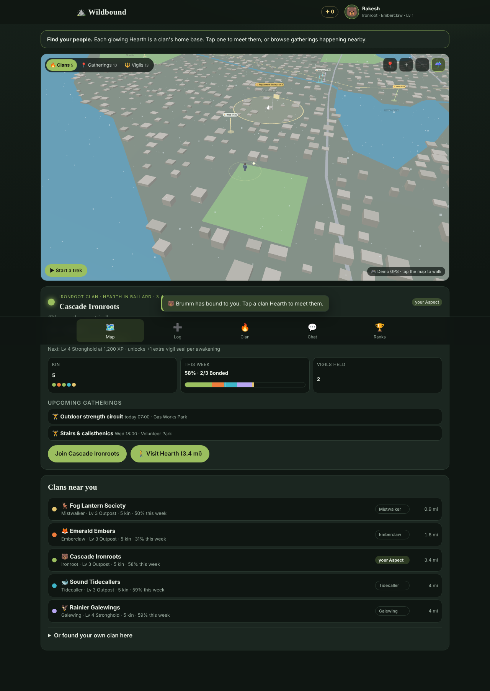
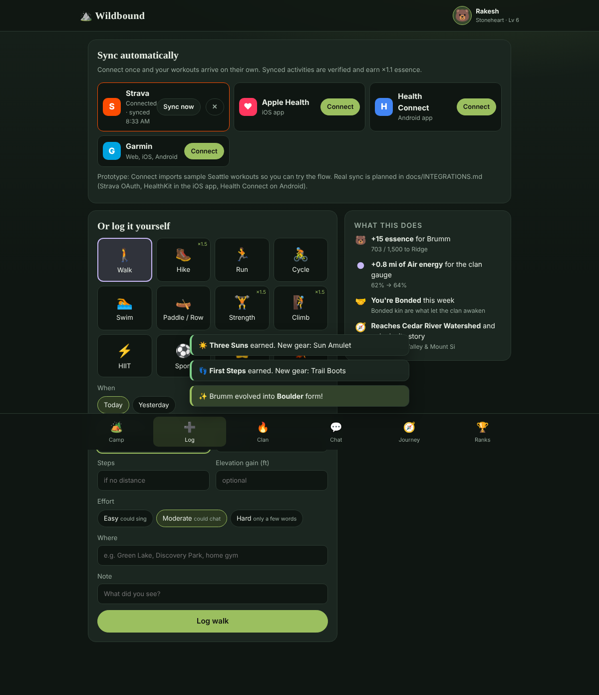
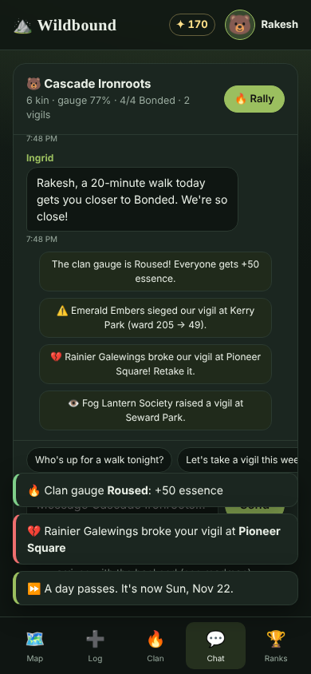

# ⛰️ Wildbound

**Move together. Hold the city.**

Wildbound is a clan-based movement game set in real-world Seattle. Every walk, lift, match and swim grows your spirit and charges your clan. When enough of your kin move each week, the clan **awakens** and earns Seals to raise **vigils** on real landmarks such as the Space Needle, Pike Place and Gas Works. A vigil pays the whole clan daily rewards until a rival clan moves more and breaks it.

> We evolved as hunter-gatherers: walking, carrying, climbing and roaming in tribes. Wildbound tries to bring back that instinct: move with your people, toward a shared horizon, and get curious about the land along the way.

| 3D Seattle map + vigils | Log + "What this does" | Clan chat (mobile) |
|---|---|---|
|  |  |  |

## Product plan

| Phase | What ships | Why |
|---|---|---|
| **1 · Social core** | Pick a primary Aspect → find a clan **on the map** (each clan has a Hearth in a neighborhood) → log or sync activity → clan chat → weekly Awakening → **gatherings**: clan activities happening nearby that anyone can join and check in to | Clans and real meetups are fun with 3 friends. This builds density before territory matters. |
| **2 · Territory** | **Vigils** on landmarks, unlocked at **clan Level 3 · Outpost**, with tribute, boons, sieges and the Lumen shop | Competition between clans needs enough players nearby, verified GPS, and safety rules. The goal is visible (locked) from day one. |

Clan levels: Lv 1 Campfire (chat, Awakening, join gatherings) → Lv 2 Hearth (host gatherings) → **Lv 3 Outpost (vigils)** → Lv 4 Stronghold (+1 Seal per Awakening) → Lv 5 Citadel (vigils fade slower). Clan XP comes from members' miles, Awakenings and gathering attendance.

## Core loop

```
Move in real life ──► GPS trek on the map · Strava / Apple Health / Health Connect / Garmin · manual log
        │
        ├─► Essence ──────► your spirit evolves (primary Aspect ×1.5, secondary ×1.25)
        ├─► Aspect energy ─► your clan's WEEKLY AWAKENING gauge (every activity counts, in any clan)
        ├─► Active day ────► you become "Bonded" (3 days this week)
        └─► Pledgeable km ─► fortify / siege / establish VIGILS on real Seattle landmarks

Gauge full + 60% of kin Bonded ──► ⚡ CLAN AWAKENS
   • Aspect Power for 2 weeks   • +2 Vigil Seals   • vigils empowered (½ decay, ×1.5 tribute)   • +150 essence, +100 ✦ each

Each vigil held ──► daily ✦ Lumens for every member + a clan-wide boon, until a rival breaks the ward
```

### The five Aspects
| Aspect | Motto | Movements | Spirit |
|---|---|---|---|
| 🐻 **Ironroot** | Lift the world. | Gym, strength, climbing | Brumm, the iron-rooted bear |
| 🦊 **Emberclaw** | Play like wildfire. | Sport, HIIT, dance | Ashka, the ember fox |
| 🐋 **Tidecaller** | Move like water. | Swim, paddle, yoga | Nerra, the tide orca |
| 🦅 **Galewing** | Outrun the wind. | Run, cycle | Kestra, the gale kestrel |
| 🦌 **Mistwalker** | Wander. Wonder. | Walk, hike | Tahl, the mist elk |

**Gym and sport?** Pick Ironroot as primary and Emberclaw as secondary. Both grow your spirit, and **every activity charges your clan's gauge in full** under its own Aspect, whatever the clan's Aspect is. The Aspect that leads the week decides which Power the clan awakens. A balanced clan, with no Aspect above 35%, awakens **Convergence**.

### Vigils
Thirteen Seattle landmarks (Space Needle, Pike Place, Gas Works, Kerry Park, Ballard Locks, Lumen Field, Green Lake and more) each pay tribute and grant a boon to the clan holding them. See [docs/VIGILS.md](docs/VIGILS.md) for the full design and a rewards brainstorm.

## Features
- **3D Seattle map** (Three.js) built from real coordinates: Puget Sound, Elliott Bay, Lake Union, Lake Washington, Green Lake, parks, I-5 / SR 99 / I-90 / SR 520, the Burke-Gilman Trail, about 3,000 procedural buildings, landmark models with clan-colored vigil beacons and ward rings, and Rainier, the Olympics and the Cascades on the horizon. The sky follows Seattle's time of day, with optional rain.
- **Live GPS tracking:** "📍" follows your phone's position and "Start a trek" records your route, then logs it as a verified walk, run or ride by speed. In the Claude preview, location is blocked, so **Demo GPS** lets you tap the map to walk.
- **Google Photorealistic 3D** (optional): paste your own Maps API key in Me → Settings. See `js/gmaps.js`.
- **Installable on the phone (PWA):** manifest and service worker, so you can add it to your home screen from the GitHub Pages URL.
- **Lumen shop:** Vigil Seals, Ward Shields, Rally Horns and spirit auras.
- **Clan:** weekly Awakening, "your part" checklist, vigils held, kin with Bonded status, journey, Powers.
- **Chat:** activity cards, cheers, Rally, and vigil alerts ("Emerald Embers sieged Gas Works").
- **Ranks:** clans (distance per member × Bonded share + vigils), kin awards, vigil ownership, and Aspect balance.
- **Badges are gear** worn by your avatar on the map.

## Run it

There is no build step. It's plain HTML, CSS and ES modules.

```bash
npm start
```

Then open http://localhost:5173. Alternatively, run `python3 -m http.server` and open http://localhost:8000.

```bash
npm test
```

The engine tests use the built-in Node test runner and need Node 18 or newer, with no dependencies.

### Deploy to GitHub Pages (and put it on your phone)
1. On GitHub, go to **Settings → Pages → Deploy from branch → `main` / root**.
2. Open `https://<you>.github.io/wildbound/` on your phone, tap **📍** on the map, and allow location.
3. Use **Share → Add to Home Screen** (iOS) or **Install app** (Android) to install it.

Background tracking with the screen off needs a native wrapper (for example Capacitor) and is on the roadmap.

## Project structure

```
index.html          App shell
css/styles.css      Theme (dark "campfire" palette, accent colour per element)
js/data.js          Elements, activities, expeditions + lore, badges, seed clans
js/engine.js        Game rules: scoring, spirits, trials, clans, expeditions, badges (no DOM)
js/store.js         Persistence (localStorage; swap for a backend)
js/app.js           UI views and event wiring
js/map3d.js         Built-in 3D Seattle map (Three.js r128, vendored in vendor/)
js/geo.js           Projection, distances, simplified Seattle basemap
js/tracker.js       GPS / Demo GPS trek tracking
js/gmaps.js         Optional Google Photorealistic 3D adapter (your API key)
js/sync.js          Activity sources (demo data; see docs/INTEGRATIONS.md)
sw.js, manifest.webmanifest   Installable PWA
tests/              Unit tests for the engine
docs/CONCEPT.md     Game design document and roadmap
```

The engine is kept free of DOM code on purpose, so the same rules can later run on a server. That matters for anti-cheat and real multiplayer.

## Prototype limitations

- Activities are self-reported, and data stays in your browser's localStorage.
- Other clan members, rival clans and chat replies are **simulated**. **⏩ Simulate a day** on the Clan tab lets them move, collects vigil tribute, lets rivals siege, and advances a demo clock.
- Everything is stored in your browser. Shared, real multiplayer vigils need a backend (next step).
- Sync buttons import sample workouts. Real integrations need a backend and native apps (see [docs/INTEGRATIONS.md](docs/INTEGRATIONS.md)).
- Map coordinates and distances are approximate and for illustration only.

See [docs/CONCEPT.md](docs/CONCEPT.md) for the full design and roadmap.

## License
MIT
