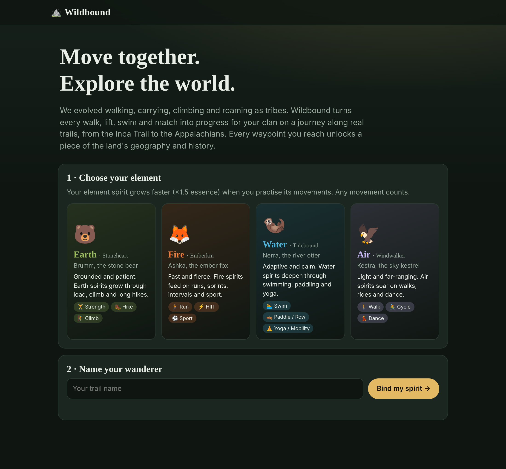
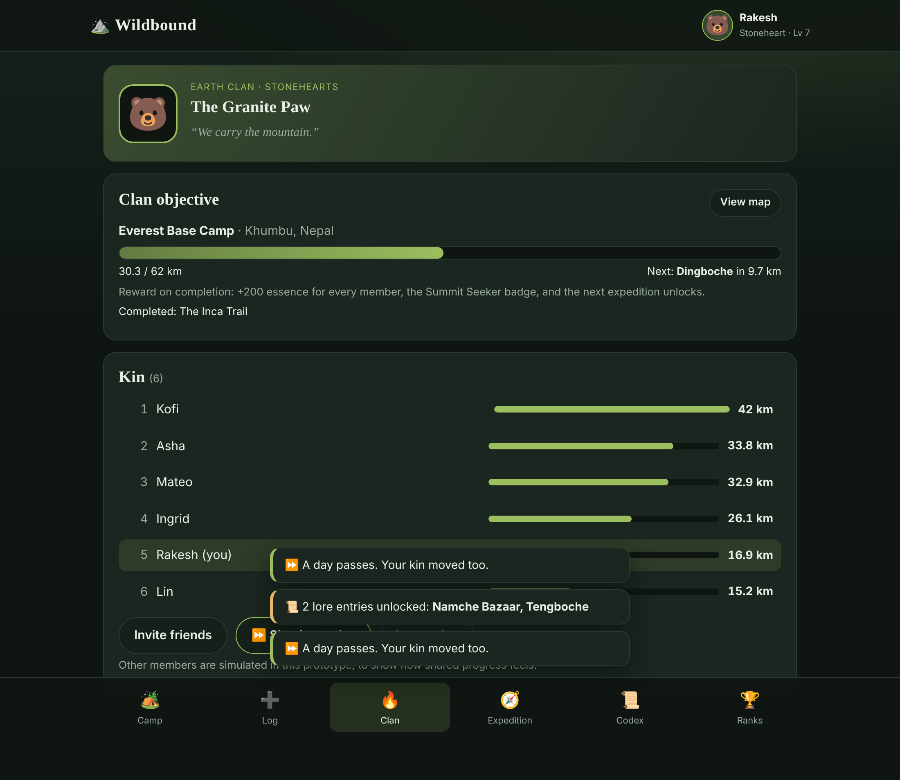
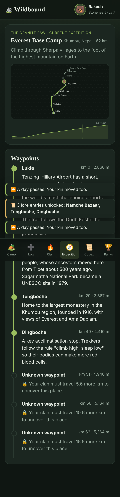

# ⛰️ Wildbound

**Move together. Explore the world.**

Wildbound is a clan-based movement game. Your walks, lifts, runs, swims and matches feed an elemental spirit companion. They also carry your clan along **real-world trails**, such as the Inca Trail, Everest Base Camp, Hadrian's Wall, the Camino de Santiago and the Appalachian Trail. Each waypoint your clan reaches unlocks a short piece of the geography and history of that land.

> We evolved as hunter-gatherers: walking, carrying, climbing and roaming in tribes. Wildbound tries to bring back that instinct: move with your people, toward a shared horizon, and get curious about the land along the way.

| Choose your element | Clan objective | Expedition (mobile) |
|---|---|---|
|  |  |  |

## Core loop

```
 Move in real life ──► Log activity ──► Essence (grows your spirit)
                                   └──► Trail km (moves your clan's expedition)
                                                 │
                     Waypoint reached ◄──────────┘
                            │
               Lore unlocked (geography + history)
                            │
            Expedition complete ──► clan rewards ──► next expedition
```

## Features (prototype v0.1)

- **Four element spirits:** Earth 🐻 (strength, hiking, climbing), Fire 🦊 (running, HIIT, sport), Water 🦦 (swimming, paddling, yoga) and Air 🦅 (walking, cycling, dance). Activities that match your element earn **×1.5 essence**, but every kind of movement counts.
- **Spirit evolution:** your spirit grows through four forms as essence builds (for example, Pebble → Boulder → Ridge → Mountain).
- **Fair scoring across activities:** distance activities convert real km into trail km, with weighting per activity (cycling ×0.35, swimming ×4). Strength, sport and yoga convert effort minutes into trail km.
- **Clans:** join a clan or found your own. All members add to one shared expedition. The kin leaderboard shows everyone's contribution.
- **Expeditions on real trails:** a stylised route map and elevation profile, drawn from approximate waypoint coordinates.
- **Codex of the Land:** 46 lore entries about the places on each route.
- **Daily trials:** three objectives per day, always including one for your element.
- **Badges, streaks, and the "Balance of the Elements"** leaderboard.
- **Spirit whispers:** contextual nudges from your companion. These are rule-based for now and designed to be replaced by an LLM.

## Run it

There is no build step. It's plain HTML, CSS and ES modules.

```bash
npm start
```

Then open http://localhost:5173. Alternatively, run `python3 -m http.server` and open http://localhost:8000.

```bash
npm test
```

The engine tests use the built-in Node test runner and need Node 18 or newer, with no dependencies.

### Deploy to GitHub Pages
Go to **Settings → Pages → Deploy from branch → `main` / root**. The app is fully static.

## Project structure

```
index.html          App shell
css/styles.css      Theme (dark "campfire" palette, accent colour per element)
js/data.js          Elements, activities, expeditions + lore, badges, seed clans
js/engine.js        Game rules: scoring, spirits, trials, clans, expeditions, badges (no DOM)
js/store.js         Persistence (localStorage; swap for a backend)
js/app.js           UI views and event wiring
tests/              Unit tests for the engine
docs/CONCEPT.md     Game design document and roadmap
```

The engine is kept free of DOM code on purpose, so the same rules can later run on a server. That matters for anti-cheat and real multiplayer.

## Prototype limitations

- Activities are self-reported, and data stays in your browser's localStorage.
- Other clan members are **simulated** so you can feel shared progress. Use **⏩ Simulate a day** on the Clan tab.
- Map coordinates and distances are approximate and for illustration only.

See [docs/CONCEPT.md](docs/CONCEPT.md) for the full design and roadmap.

## License
MIT
